# SciSim Lab — numerical methods & physical simulations, verified

**Live demo:** [sci-sim-lab-jeevan.vercel.app](https://sci-sim-lab-jeevan.vercel.app)

A browser laboratory of numerical methods written from scratch in TypeScript. You can watch symplectic integrators keep orbits stable while RK4 drifts, estimate a Lyapunov exponent live, run a Barnes–Hut galaxy collision, push a heat solver past its CFL limit, see the 2D Ising model reproduce Onsager's phase transition, and fit an epidemic model to noisy data.

Every algorithm comes with a test that measures what theory predicts: convergence orders, conservation laws, analytic solutions and cross-checks against SciPy. **70 tests, all passing.**

**Tech:** TypeScript (strict) · React 19 · Vite 8 (Rolldown) · Tailwind CSS v4 · KaTeX · Web Workers · Node's built-in test runner. There are **no numerical libraries**: ODE solvers, the FFT, LU and tridiagonal solvers, the quadtree, the RNG and the optimiser are all in [`src/numerics/`](src/numerics).

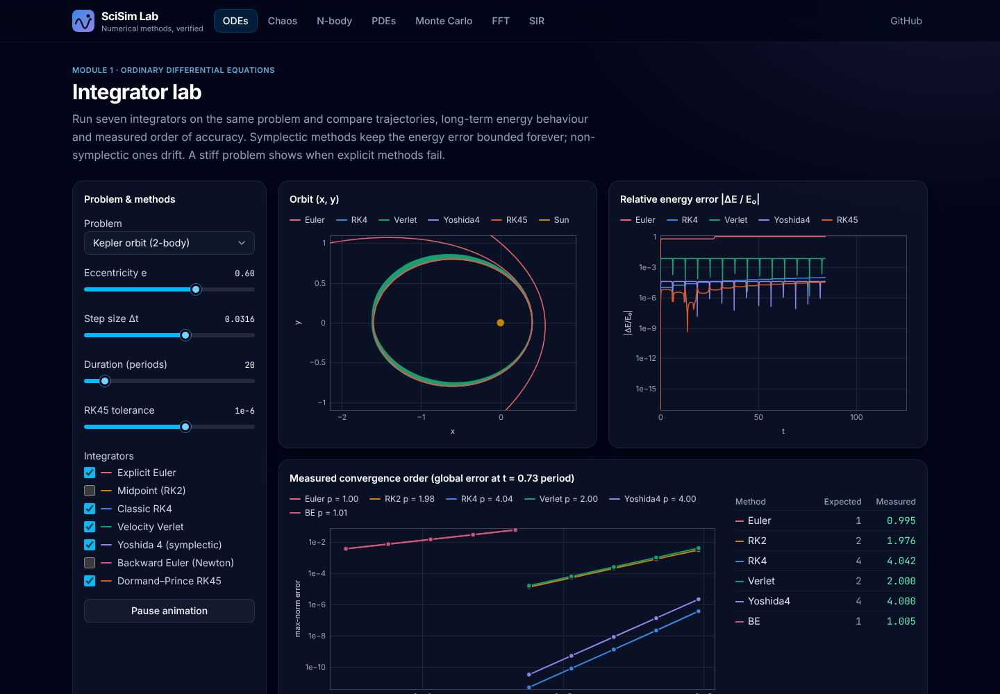

## Modules

### 1 · Integrator lab (ODEs)
- **Seven integrators:** explicit Euler, midpoint (RK2), classic RK4, **adaptive Dormand–Prince RK5(4)** (embedded error estimate, FSAL, step-size control, Hairer's dense output), **velocity Verlet**, **Yoshida 4th-order symplectic**, and **backward Euler** solved by Newton's method (analytic Jacobian, LU with partial pivoting).
- Kepler orbit (any eccentricity, with an exact solution from Kepler's equation), the nonlinear pendulum (exact period from the AGM) and the harmonic oscillator.
- Side-by-side orbits and phase portraits, a **log-scale energy-drift plot** (bounded for symplectic methods, secular drift for RK4 and Euler), and a **log–log convergence plot with fitted slopes**, computed in a Web Worker.
- **Stiffness demo** (Van der Pol up to μ = 1000, Robertson kinetics): fixed-step RK4 diverges, RK45 needs about 134k steps, and adaptive backward Euler needs about 4.8k.

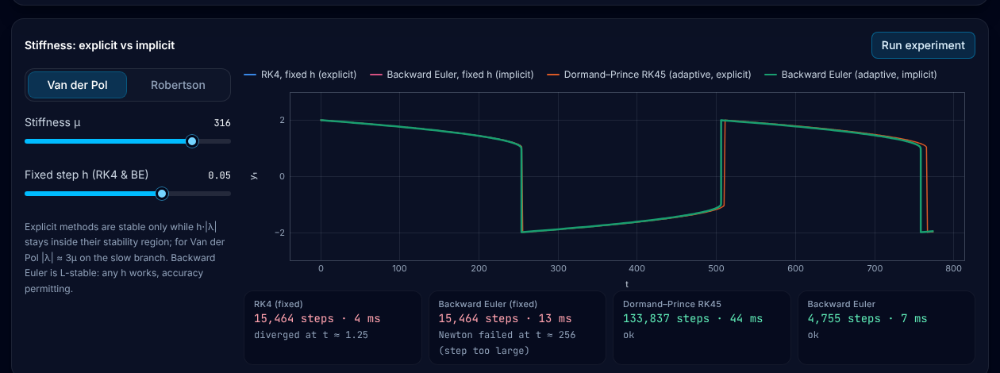

### 2 · Chaos
- **Lorenz attractor** in 3D. Drag to rotate it. Two trajectories start 10⁻⁹ apart, and their separation is plotted against e^{λ₁t}.
- **Largest Lyapunov exponent, estimated live** with Benettin's renormalisation method (it converges to about 0.90; the literature value is 0.9056).
- **Double pendulum** with trails, sensitivity to initial conditions and a live energy-conservation check.
- **Logistic map** bifurcation diagram (density-rendered, zoomable) with the exact-derivative Lyapunov exponent λ(r) underneath.

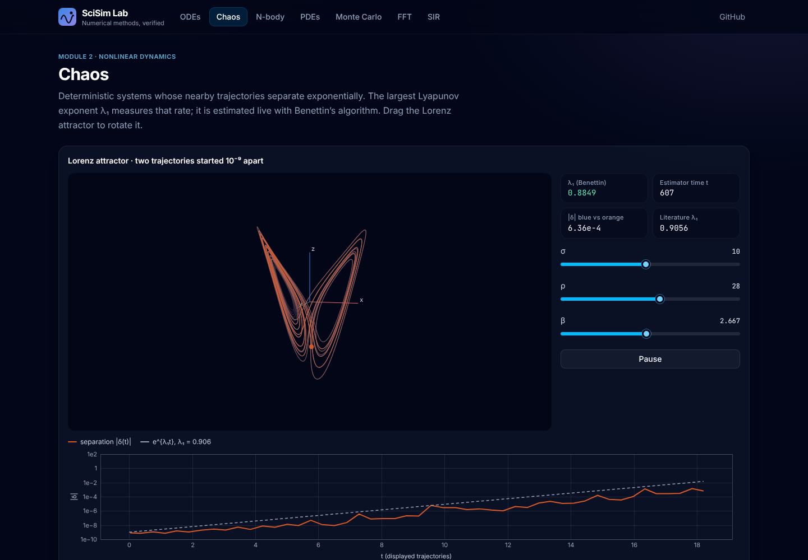

### 3 · N-body gravity
- **Barnes–Hut quadtree** in flat typed arrays with an explicit traversal stack, plus **quadrupole moments**, compared against **direct O(N²)** summation. Plummer softening and kick–drift–kick leapfrog.
- Presets: **galaxy collision** (2 × 1000 stars), the **figure-8 three-body choreography**, a **solar-system-like** system with an asteroid belt, and cold collapse.
- Live read-outs: ms per force evaluation, interactions per step, force error against direct summation, |ΔE/E₀|, total momentum, |ΔL/L₀|. You can also overlay the quadtree.
- **Scaling benchmark in a Web Worker:** the measured slope is 1.98 for direct summation and 1.15 for Barnes–Hut.

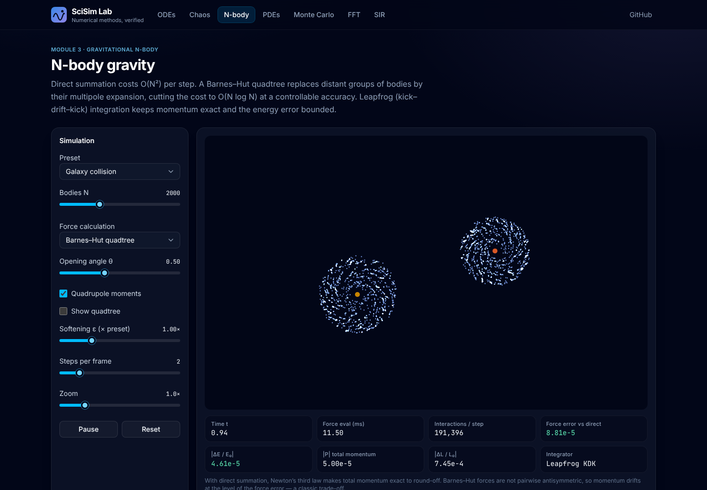
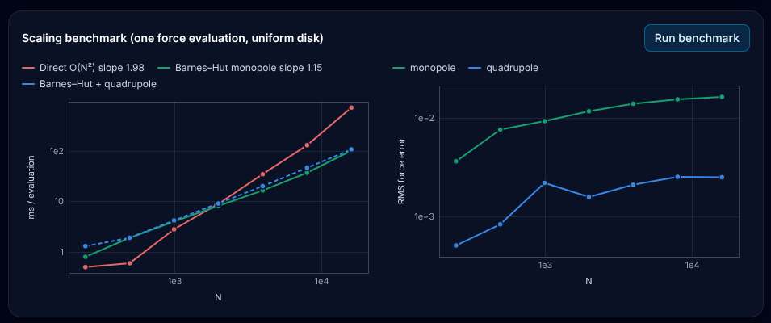

### 4 · PDEs
- **Heat equation:** FTCS with a live **CFL / mesh-ratio check** (r ≤ 1/4) against **Peaceman–Rachford ADI**, a Crank–Nicolson-type scheme solved with the Thomas algorithm that is unconditionally stable. Paint heat and cold with the mouse, or run the Fourier-mode test against the analytic decay.
- **Wave equation:** leapfrog with **draggable point sources**, **reflecting or absorbing (Mur) boundaries**, a double-slit preset, a Courant-number stability warning and a discrete-energy plot.
- **Gray–Scott reaction–diffusion** with five pattern presets and paintable initial conditions.
- **Viridis, inferno and cool–warm colormaps**, implemented as lookup tables. All solvers are typed-array CPU code running at 60 fps, so nothing depends on WebGL.

| Heat (ADI, Fourier-mode test) | Wave (two sources) | Gray–Scott |
|---|---|---|
| 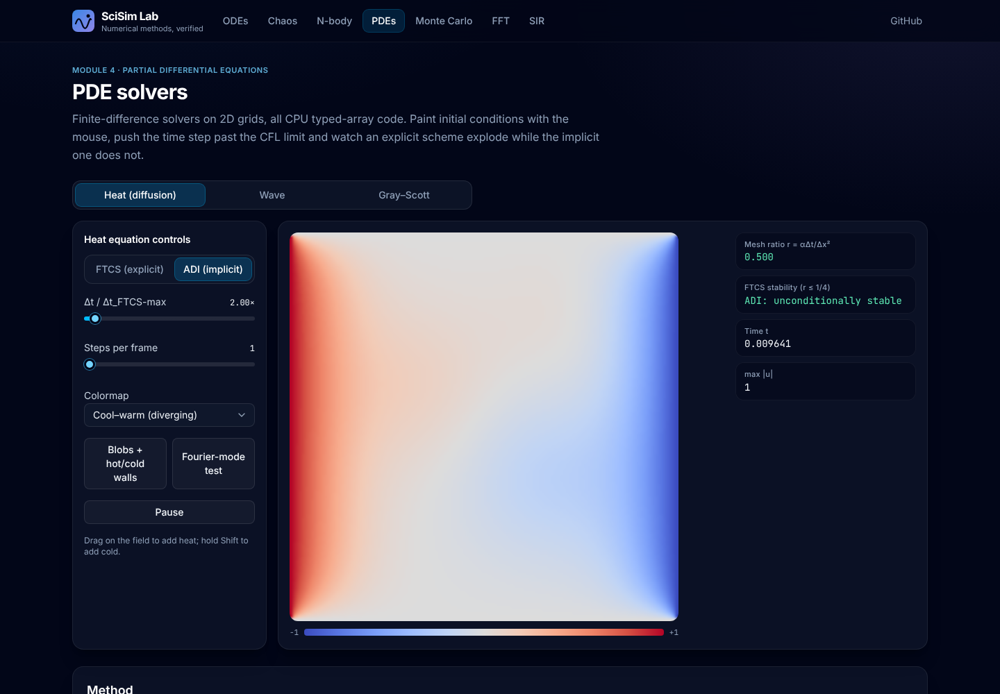 | 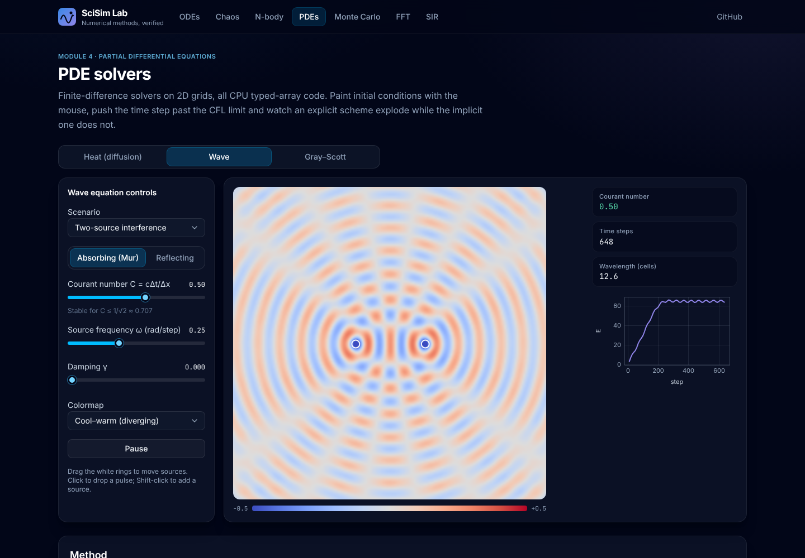 | 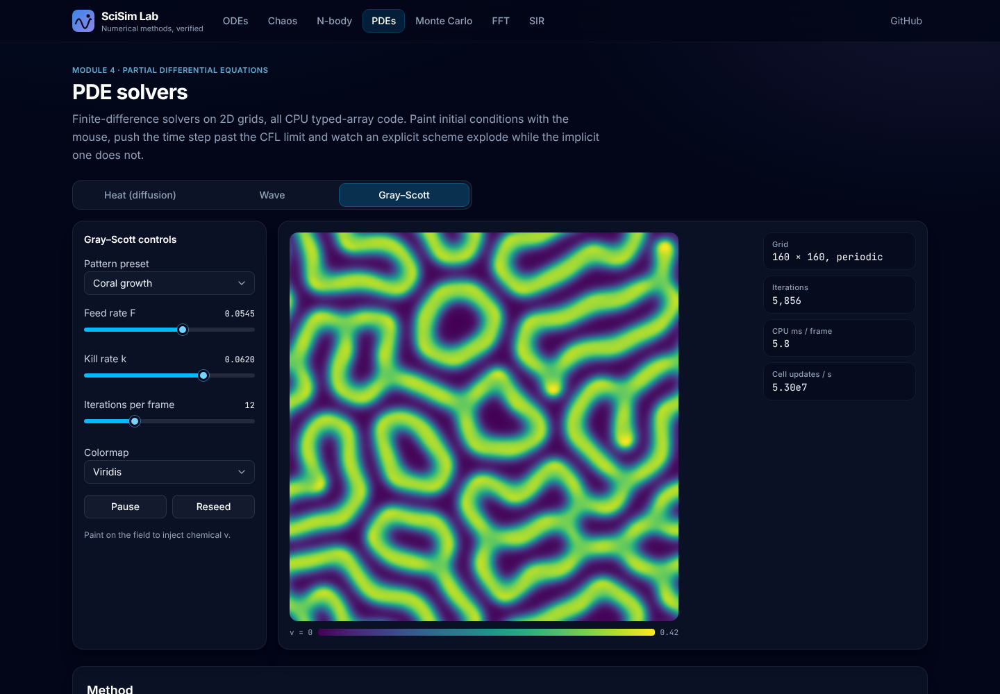 |

### 5 · Statistical physics & Monte Carlo
- **2D Ising model** with **Metropolis** and **Wolff cluster** updates. The Wolff energy update is incremental, so each step costs O(cluster).
- A **temperature sweep** runs in a Web Worker and streams ⟨|m|⟩, ⟨e⟩, χ and C, overlaid on **Onsager's exact magnetisation and energy**. The energy uses a complete elliptic integral computed with the AGM.
- **Monte Carlo π:** hit-or-miss and mean-value estimators both show the N^(−1/2) error law, while randomly shifted quasi-Monte Carlo reaches about N^(−1).
- **Random-walk diffusion** with 3000 walkers and MSD(t) = t.

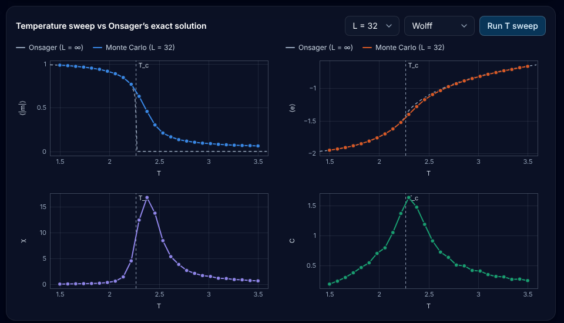

### 6 · Signal processing
- **Iterative radix-2 FFT** (bit reversal, cached twiddles) and its inverse.
- A signal composer (three sines plus noise) with Rectangular, Hann, Hamming and Blackman windows.
- An **STFT spectrogram** of a chirp, with a window-length control that shows the time–frequency trade-off.
- **Windowed-sinc FIR filter design** (low, high and band-pass) with frequency response and filtered output.
- An optional **live microphone spectrum** that uses the page's own FFT.

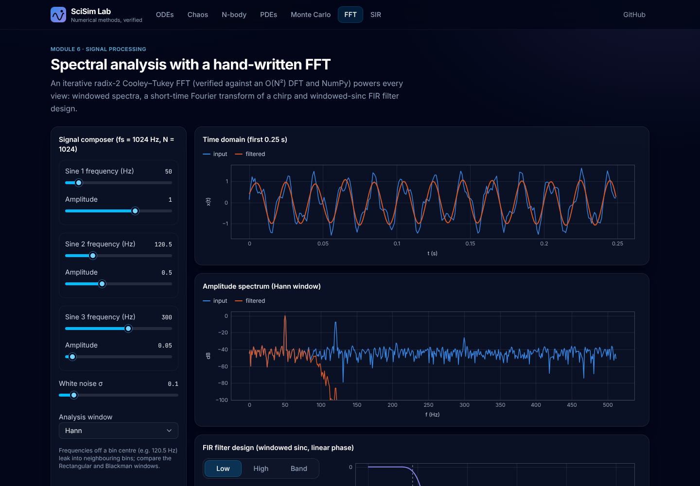

### 7 · Epidemics
- **SIR and SEIR models** (RK4) with read-outs for R₀, peak, final size (Newton solve of z = 1 − e^{−R₀z}) and the herd-immunity threshold.
- **Inverse problem:** synthetic data with log-normal noise is fitted by **Nelder–Mead least squares**. The fit is animated: the simplex path in (β, γ), the objective against iteration, and the recovered R₀.

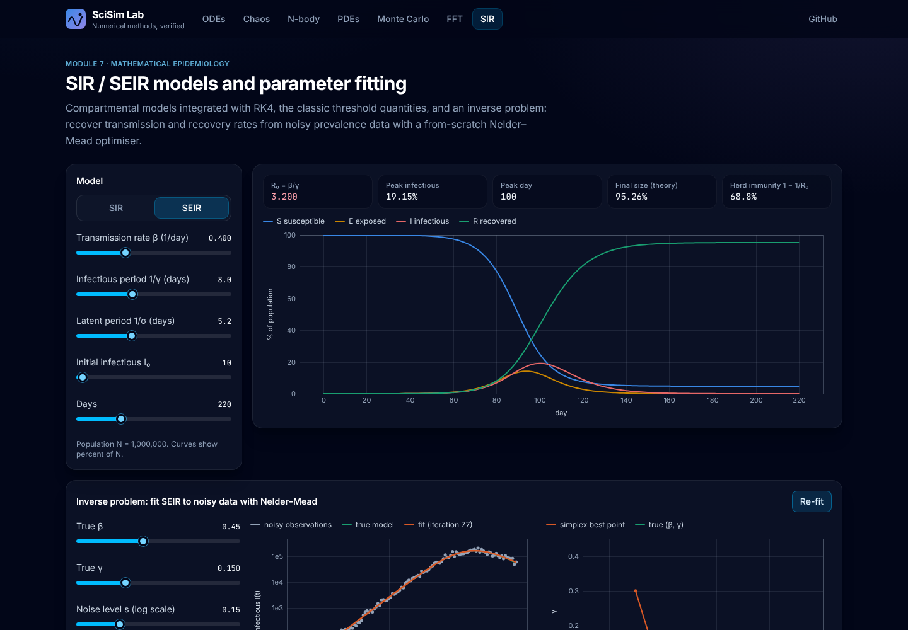

Every page has a **Method** section with the governing equations rendered in KaTeX, the discretisation, stability conditions, what the tests verify, and literature references.

## Verification

`npm test` runs the suite under `tests/` with Node's built-in test runner. Node ≥ 22.18 runs the `.ts` files directly. The numbers below are from that run:

| Check | Expected | Measured |
|---|---|---|
| Explicit Euler: convergence order (harmonic / Kepler e = 0.5) | 1 | 1.049 / 0.995 |
| Midpoint RK2: order | 2 | 2.007 / 1.987 |
| Classic RK4: order | 4 | 4.008 / 4.034 |
| Velocity Verlet: order | 2 | 2.000 / 2.000 |
| Yoshida-4: order | 4 | 4.000 / 4.000 |
| Backward Euler (Newton): order | 1 | 0.954 / 0.999 |
| Dormand–Prince RK45: global error vs requested tol (harmonic, logistic) | ≤ 10 × tol | 3.6–4.4 × tol, 0.13–0.37 × tol |
| RK45: tolerance proportionality d log err / d log tol (Kepler e = 0.6) | ≈ 1 | 1.059 |
| RK45: dense output error (harmonic, rtol 1e-9) | < 1e-7 | ✓ |
| RK45 vs **SciPy DOP853** (Lorenz, Van der Pol μ = 10, Kepler e = 0.9) | < 1e-8 | 4.5e-11, 4.3e-13, 1.7e-11 |
| RK45 step count vs **SciPy RK45** (Kepler e = 0.6, tol 1e-8) | similar | 75 vs 75 |
| Verlet \|ΔE/E\| over 10⁵ steps (pendulum θ₀ = 2) | bounded, no growth | 1.63e-3 in both halves |
| RK4 energy error over 10⁵ steps (Kepler) | secular growth | 7.6e-4 → 7.5e-3 |
| Adaptive backward Euler on Robertson vs **SciPy Radau** | < 0.2% | 0.03–0.1% (189 steps) |
| Stiff Van der Pol μ = 300: RK45 vs implicit steps | ≫ | 31 283 vs 45 |
| FFT vs naive DFT, N = 1…1024 | < 1e-12 · √N | 6.7e-15 · √N |
| FFT vs **numpy.fft**; inverse round-trip up to N = 65 536 | < 1e-12 | ✓ |
| Parseval Σ\|x\|² = (1/N)Σ\|X\|² (N = 8192) | < 1e-12 | 2.6e-15 relative |
| FIR low-pass (Blackman, 101 taps) | > 60 dB stopband | −83.1 dB; matches **scipy.signal.firwin** to 1e-12 |
| Heat FTCS vs analytic e^{−2π²t} sin πx sin πy | < 0.2% | 3.4e-4 |
| Heat ADI at 40× the FTCS step limit | < 1% | 1.5e-4 |
| ADI temporal order | 2 | 2.00, 2.00 |
| FTCS above r = 1/4 | blows up | ✓ |
| Wave standing mode ω = cπ√2 (800 steps) | < 5e-3 | 1.4e-4 |
| Wave energy: reflecting / absorbing (Mur) box | ≈ 100% / < 5% | 98.4% / 0.00% |
| Barnes–Hut θ = 0.5 RMS force error vs direct, N = 4000 (monopole / quadrupole) | < 2% / < 0.5% | 1.40% / 0.24% |
| Barnes–Hut error scaling d log err / d log θ (monopole / quadrupole) | ≈ 2 / ≈ 3 | 2.55 / 3.28 |
| Figure-8 choreography returns after T = 6.3259 | < 1e-4 | 2.4e-7 |
| Direct N-body: \|P\|, \|ΔL/L\|, \|ΔE/E\| after 500 steps | round-off, round-off, O(dt²) | 1.2e-15, 7.8e-15, 2.5e-6 |
| Ising T = 0.5: e, \|m\| | −2, 1 | −2.000000, 1.000000 |
| Ising T = 100: e (high-T series −2 tanh β), \|m\| | ≈ −0.020, O(1/L) | −0.017, 0.026 |
| Ising T = 2.0, L = 32 vs **Onsager**: Metropolis e, \|m\| | −1.7456, 0.9113 | −1.7453, 0.9123 |
| Ising T = 2.0, L = 32 vs **Onsager**: Wolff e, \|m\| | −1.7456, 0.9113 | −1.7471, 0.9119 |
| Onsager energy (AGM) vs **scipy.special.ellipk** | < 1e-12 | ✓ |
| χ and C peak near T_c ≈ 2.269 | 2.1–2.5 | ✓ |
| Lorenz λ₁ (Benettin, t = 1000) | 0.9056 | 0.9025 |
| Logistic map λ(4) = ln 2; period 2 at r = 3.2, period 4 at r = 3.5 | exact | ✓ |
| Monte Carlo error slope: hit-or-miss / mean-value / QMC | −0.5 / −0.5 / ≈ −1 | −0.508 / −0.509 / −1.006 |
| Random-walk MSD slope | 1 | 1.0051 |
| Nelder–Mead on Rosenbrock | (1, 1) | (1.000000, 1.000000), 171 iterations |
| SIR fit: β, γ (true 0.45, 0.15, 10% noise) | < 3% | 0.4488, 0.1503 (R₀ 2.987) |
| SEIR fit: β, γ | < 3% | 0.4452, 0.1473 (R₀ 3.023) |
| SIR (RK4) vs **SciPy DOP853** at day 100 | < 1e-6 relative | ✓ |

### SciPy cross-check
[`scripts/scipy_crosscheck.py`](scripts/scipy_crosscheck.py) computes independent reference values with SciPy and NumPy: DOP853 and Radau solutions, RK45 step counts, `numpy.fft`, `scipy.signal` windows and `firwin`, and `scipy.special.ellipk`. It writes them to [`tests/fixtures/scipy.json`](tests/fixtures/scipy.json), which `tests/crosscheck.test.ts` consumes. The fixture is committed, so CI does not need Python. To regenerate it:

```bash
pip install scipy numpy
npm run crosscheck
```

## Architecture

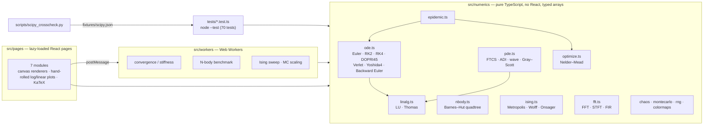

Design notes:
- **Numerics are isolated from the UI.** `src/numerics` has no DOM or React imports, so the same code runs in the browser, in Web Workers and in Node tests.
- **No allocation in hot loops.** Steppers preallocate their stage vectors, the quadtree reuses flat `Float64Array`/`Int32Array` pools with an explicit stack, and PDE grids swap buffers.
- **Heavy work runs off the main thread:** convergence studies, stiff solves, the O(N²) benchmark and the Ising temperature sweep (which streams its results). The benchmark pauses the live simulation so the two do not compete for CPU.
- **Charts are hand-rolled canvas plots** with linear and log axes, legends and a hover read-out. The categorical palette is checked for colour-vision-deficiency separation on the dark surface. Scalar fields are drawn through colormap LUTs into `ImageData`.
- **Each page is lazy-loaded** (`React.lazy`), and KaTeX loads only with the pages that need it.

```
src/
├── numerics/        # all algorithms (ode, nbody, pde, ising, fft, optimize, epidemic, chaos, …)
├── workers/         # Web Worker entry points
├── components/      # Plot, FieldCanvas, Tex, UI controls
├── pages/           # one lazy-loaded page per module
└── lib/             # hooks, palette, formatting, worker hooks
tests/               # node --test verification suite + SciPy fixture
scripts/             # scipy_crosscheck.py
```

## Running locally

```bash
npm ci
npm run dev        # http://localhost:5173
npm test           # verification suite (Node ≥ 22.18; runs .ts natively)
npm run lint       # oxlint
npm run build      # type-check (tsc -b) + production build
npm run preview    # serve the production build
```

CI (GitHub Actions, Node 22) runs `npm ci`, lint, test and build on every push.

## What this demonstrates

- **Numerical analysis in practice:** order of accuracy, stability regions and stiffness, CFL conditions, symplectic geometry, error estimation and adaptive control, multipole approximations, and Monte Carlo variance.
- **Verification culture:** each method is tested against theory (measured orders, analytic solutions, exact statistical-mechanics results, conservation laws) and against an independent implementation (SciPy and NumPy).
- **Performance-aware engineering:** typed arrays, allocation-free inner loops, O(N log N) tree codes, O(N) tridiagonal solves, and Web Workers so the UI stays responsive.
- **Scientific communication:** interactive visualisations, with the mathematics and references on each page.

## Author

**Jeevan** · [github.com/Jeevan2410](https://github.com/Jeevan2410)

MIT licensed.
